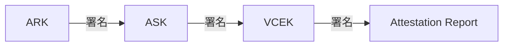
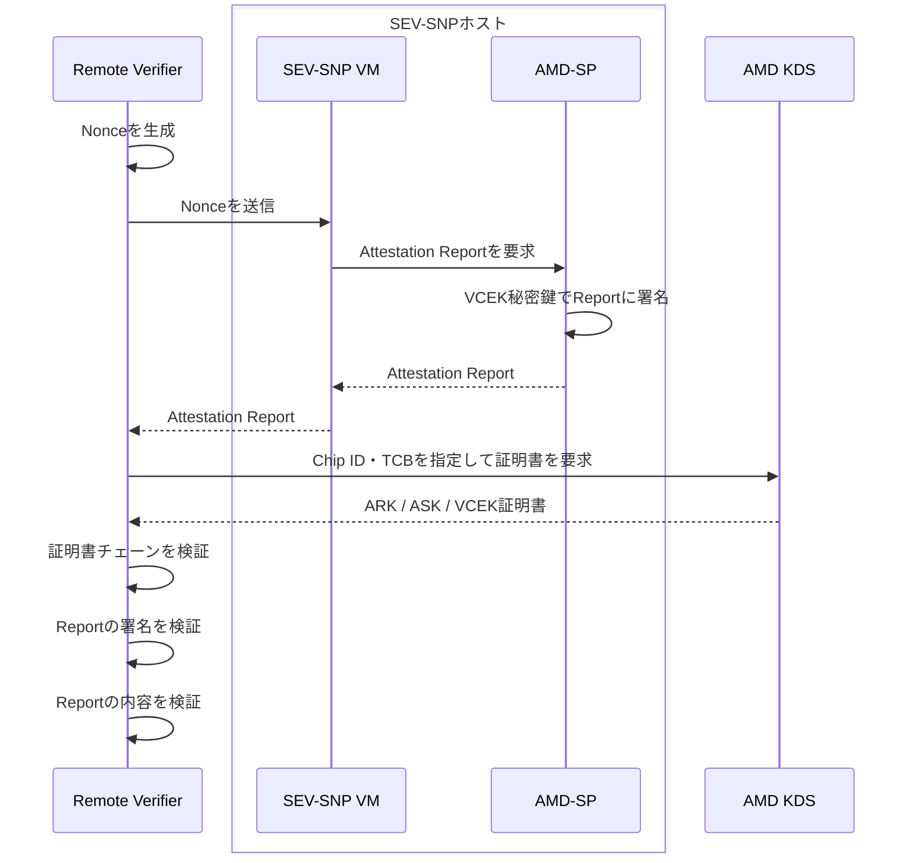

Proxmox VEでAMD SEV-SNPを有効化し、実際に仮想マシンを起動してみます。

## 1. 環境

以下の環境で検証しました。

- マザーボード: Supermicro H12SSW-NT (BIOS Version 3.6, CPLD Version A2.C2.01)
- CPU: AMD EPYC 7543P
- PSP Firmware
  - BootLoader Version: 0.13.0.80
  - SMU FW Version: 0.45.104.0
  - ABL Version: 100F5010
  - SEV FW Version: 1.1.3A.1
- Proxmox VE 9.1.6
- Linux Kernel 6.17.13-1-pve

## 2. ホストマシンでのSEV-SNPの有効化

Proxmox VEのホストマシンでSEV-SNPが有効になっているか確認します。

私の環境では利用できない状態でした。

```bash
user@pve:~$ grep -m1 '^flags' /proc/cpuinfo | tr ' ' '\n' | grep -E '^(sev|sev_es|sev_snp)$'
```

```bash
user@pve:~$ sudo dmesg | grep -iE 'SEV|SNP|RMP'
[   22.439239] ccp 0000:42:00.1: SEV: memory encryption not enabled by BIOS
```

```bash
user@pve:~$ cat /sys/module/kvm_amd/parameters/sev
N
```

有効化するにはBIOSから設定を変更します。私の環境では以下の項目を変更しました。

- Advanced / NB Configuration
  - SEV-SNP Support: `Disabled` → `Enabled`


- Advanced / CPU Configuration
  - SMEE: `Auto` → `Enabled`
  - SEV-ES ASID Space Limit Control: `Auto` → `Manual`
  - SEV-ES ASID Space Limit: `1` → `100`
  - SNP Memory (RMP Table) Coverage: `Auto` → `Enabled`


Proxmox起動後、SEV-SNPが有効になっていることを確認できます。

```bash
user@pve:~$ grep -m1 '^flags' /proc/cpuinfo | tr ' ' '\n' | grep -E '^(sev|sev_es|sev_snp)$'
sev
sev_es
sev_snp
```

```bash
user@pve:~$ sudo dmesg | grep -iE 'SEV|SNP|RMP'
[    0.000000] SEV-SNP: RMP table physical range [0x0000007fce800000 - 0x000000804edfffff]
[    1.494924] AMD-Vi: IOMMU SNP support enabled.
[    1.516340] AMD-Vi: Extended features (0x841f77e022094ace, 0x0): PPR X2APIC NX IA GA PC SNP
[   22.417089] ccp 0000:42:00.1: sev enabled
[   28.289002] ccp 0000:42:00.1: SEV-SNP API:1.58 build:1
[   28.341651] ccp 0000:42:00.1: SEV API:1.58 build:1
[   28.343357] kvm_amd: SEV enabled (ASIDs 100 - 509)
[   28.343361] kvm_amd: SEV-ES enabled (ASIDs 1 - 99)
[   28.343363] kvm_amd: SEV-SNP enabled (ASIDs 1 - 99)
```

```bash
user@pve:~$ cat /sys/module/kvm_amd/parameters/sev
Y
user@pve:~$ cat /sys/module/kvm_amd/parameters/sev_snp
Y
```

## 3. 仮想マシンの作成

Proxmox VEのWeb GUIから仮想マシンを作成します。ウィザードでは以下の項目を指定します。

- System
  - BIOS: OVMF (UEFI)
  - Add EFI Disk: 無効
- CPU
  - Type: host

CPUコア数などはマシンスペックに合わせて設定しました。

作成後、仮想マシンのオプションからAMD SEV設定を編集します。ダイアログのAdvancedにチェックを入れ、以下の項目を指定します。

- AMD SEV Type: AMD SEV-SNP
- Allow Debugging: 無効


## 4. 仮想マシンの起動

仮想マシンを起動し、OSをインストールします。ここではUbuntu Server 26.04をインストールしました。

実際の運用ではMeasured Boot等の手段でブートプロセスを検証する必要がありますが、本稿では扱いません。

## 5. 仮想マシン内での確認

OSインストール完了後、VM内からSEV-SNPが有効化されていることを確認できます。

```bash
ubuntu@exp-sev-snp:~$ sudo dmesg | grep -iE 'SEV|SNP|Memory Encryption'
[    2.307102] Memory Encryption Features active: AMD SEV SEV-ES SEV-SNP
[    2.307124] SEV: Status: SEV SEV-ES SEV-SNP
[    2.722705] SEV: APIC: wakeup_secondary_cpu() replaced with wakeup_cpu_via_vmgexit()
[    3.564097] SEV: Using SNP CPUID table, 33 entries present.
[    3.564104] SEV: SNP running at VMPL0.
[    3.708104] SEV: SNP guest platform devices initialized.
[    3.747444] software IO TLB: Memory encryption is active and system is using DMA bounce buffers
[    4.066961] systemd[1]: Hostname set to <exp-sev-snp>.
[    8.531767] systemd[1]: Detected confidential virtualization sev-snp.
[   10.870698] sev-guest sev-guest: Initialized SEV guest driver (using VMPCK0 communication key)
[   11.083864] kvm_amd: KVM is unsupported when running as an SEV guest
```

```bash
ubuntu@exp-sev-snp:~$ ls -l /dev/sev-guest
crw------- 1 root root 10, 263 Aug  8 15:18 /dev/sev-guest
```

## 6. Attestation Reportの取得

実際にVM内でAttestation Reportを取得してみます。ここではsnpguestを利用します。

https://github.com/virtee/snpguest

snpguestのビルドに必要なパッケージをインストールします。

```bash
ubuntu@exp-sev-snp:~$ sudo apt update
ubuntu@exp-sev-snp:~$ sudo apt install build-essential
```

Rustをインストールします。ここではRust 1.97.1を利用しました。

```bash
ubuntu@exp-sev-snp:~$ curl --proto '=https' --tlsv1.2 -sSf https://sh.rustup.rs | sh
ubuntu@exp-sev-snp:~$ . "$HOME/.cargo/env"
```

snpguestをビルドします。本稿で使用したsnpguestのリビジョンは[fbee62e](https://github.com/virtee/snpguest/tree/fbee62eb04aab08f4f55e7d9d613a39ba20e87cc)です。

```bash
ubuntu@exp-sev-snp:~$ git clone https://github.com/virtee/snpguest.git
ubuntu@exp-sev-snp:~$ cd snpguest
ubuntu@exp-sev-snp:~$ git switch -d fbee62eb04aab08f4f55e7d9d613a39ba20e87cc
ubuntu@exp-sev-snp:~/snpguest$ cargo build --release
```

作業用ディレクトリを作成します。

```bash
ubuntu@exp-sev-snp:~/snpguest$ mkdir ~/snp-lab
ubuntu@exp-sev-snp:~/snpguest$ cd ~/snp-lab
ubuntu@exp-sev-snp:~/snp-lab$ cp ~/snpguest/target/release/snpguest ./
```

Nonceを生成し、Attestation Reportを取得します。

```bash
ubuntu@exp-sev-snp:~/snp-lab$ sudo ./snpguest report attestation-report.bin request-data.bin --random --vmpl 0
```

取得したAttestation Reportを表示します。

```bash
ubuntu@exp-sev-snp:~/snp-lab$ ./snpguest display report attestation-report.bin
Attestation Report:

Version:                      5

Guest SVN:                    0

Guest Policy (0x30000):
  ABI Major:     0
  ABI Minor:     0
  SMT Allowed:   true
  Migrate MA:    false
  Debug Allowed: false
  Single Socket: false
  CXL Allowed:   false
  AEX 256 XTS:   false
  RAPL Allowed:  false
  Ciphertext hiding: false
  Page Swap Disable: false

Family ID:
00 00 00 00 00 00 00 00 00 00 00 00 00 00 00 00

Image ID:
00 00 00 00 00 00 00 00 00 00 00 00 00 00 00 00

VMPL:                         0

Signature Algorithm:          1

Current TCB:

TCB Version:
  Microcode:   222
  SNP:         29
  TEE:         0
  Boot Loader: 4
  FMC:         None

Platform Info (37):
  SMT Enabled:               true
  TSME Enabled:              false
  ECC Enabled:               true
  RAPL Disabled:             false
  Ciphertext Hiding Enabled: false
  Alias Check Complete:      true
  SEV-TIO Enabled:           false

Key Information:
    author key enabled: false
    mask chip key:      false
    signing key:        vcek

Report Data:
C6 A6 80 B5 53 BE 38 BF FC C3 2F 06 08 FE E3 D0
A4 A3 01 DF A6 28 02 1E EC EC 9B D2 03 CE 2A 93
C7 D9 32 94 CB 82 20 F6 A3 09 4C E4 EF C6 4C 78
34 84 79 2D 52 05 3A C8 3F 78 92 84 91 F7 37 AD

Measurement:
E1 6E 21 DD F0 1D 41 57 17 5C 1A 19 03 6A 4A 59
9A D1 CC 75 A5 09 7E A8 F1 6D 71 A7 EE CE 56 FA
B8 99 A4 A2 83 88 D2 9D EC B2 23 80 9F 9B EC 16

Host Data:
00 00 00 00 00 00 00 00 00 00 00 00 00 00 00 00
00 00 00 00 00 00 00 00 00 00 00 00 00 00 00 00

ID Key Digest:
00 00 00 00 00 00 00 00 00 00 00 00 00 00 00 00
00 00 00 00 00 00 00 00 00 00 00 00 00 00 00 00
00 00 00 00 00 00 00 00 00 00 00 00 00 00 00 00

Author Key Digest:
00 00 00 00 00 00 00 00 00 00 00 00 00 00 00 00
00 00 00 00 00 00 00 00 00 00 00 00 00 00 00 00
00 00 00 00 00 00 00 00 00 00 00 00 00 00 00 00

Report ID:
[REDACTED]

Report ID Migration Agent:
FF FF FF FF FF FF FF FF FF FF FF FF FF FF FF FF
FF FF FF FF FF FF FF FF FF FF FF FF FF FF FF FF

Reported TCB:

TCB Version:
  Microcode:   222
  SNP:         29
  TEE:         0
  Boot Loader: 4
  FMC:         None

CPUID Family ID:              25

CPUID Model ID:               1

CPUID Stepping:               1

Chip ID:
[REDACTED]

Committed TCB:

TCB Version:
  Microcode:   222
  SNP:         29
  TEE:         0
  Boot Loader: 4
  FMC:         None

Current Version:              1.58.1

Committed Version:            1.58.1

Launch TCB:

TCB Version:
  Microcode:   222
  SNP:         29
  TEE:         0
  Boot Loader: 4
  FMC:         None

Launch Mitigation Vector:     11

Current Mitigation Vector:    11

Signature:
  R:
48 84 42 34 09 27 B7 7F 21 65 39 68 48 D5 FA F7
72 FE 5A A9 69 00 50 44 74 37 7D A7 86 AB 1E F5
0E 28 D9 BA 7C F5 91 0F 26 7D 54 CF 73 05 A6 38
00 00 00 00 00 00 00 00 00 00 00 00 00 00 00 00
00 00 00 00 00 00 00 00
  S:
4E 54 00 DF 20 39 2F CD CB 52 D0 12 88 4D 64 29
AF 3A 6B 1C 48 93 FC 14 B0 85 59 C9 EE AA A1 DF
E4 4C 62 77 78 7D 70 4C E5 9B 34 85 54 10 A8 16
00 00 00 00 00 00 00 00 00 00 00 00 00 00 00 00
00 00 00 00 00 00 00 00
```

## 7. Attestation Reportの検証

取得したAttestation Reportの署名とNonceを検証します。実際の運用ではMeasurement等の検証も必要ですが、本稿では割愛します。

AMDのKDSから証明書をダウンロードします。

:::details 証明書の関係

- KDS (Key Distribution Service)
  - AMDが運営する証明書配布サービス
  - ARK, ASK, VCEK証明書をダウンロードできる
- ARK (AMD Root Key) 証明書
  - AMDのルートCA
  - 自己署名証明書
- ASK (AMD SEV Key) 証明書
  - 製品系列ごとの中間CA
  - ARKにより署名されている
- VCEK (Versioned Chip Endorsement Key) 証明書
  - 物理CPU固有かつTCBバージョン固有の証明書
  - ASKにより署名されている
  - 秘密鍵はCPU内部のAMD-SP (AMD Secure Processor)で管理されており取り出せない

Attestation ReportはVCEKにより署名されています。



:::

```bash
ubuntu@exp-sev-snp:~/snp-lab$ mkdir -p certs
ubuntu@exp-sev-snp:~/snp-lab$ ./snpguest fetch ca pem certs --report attestation-report.bin
ubuntu@exp-sev-snp:~/snp-lab$ ./snpguest fetch vcek pem certs attestation-report.bin
```

```bash
ubuntu@exp-sev-snp:~/snp-lab$ ls certs
ark.pem  ask.pem  vcek.pem
```

証明書チェーンを検証します。

```bash
ubuntu@exp-sev-snp:~/snp-lab$ ./snpguest verify certs certs
The AMD ARK was self-signed!
The AMD ASK was signed by the AMD ARK!
The VCEK was signed by the AMD ASK!
```

Attestation ReportがVCEKによって署名されていることを検証します。

```bash
ubuntu@exp-sev-snp:~/snp-lab$ ./snpguest verify attestation certs attestation-report.bin
Reported TCB Boot Loader from certificate matches the attestation report.
Reported TCB TEE from certificate matches the attestation report.
Reported TCB SNP from certificate matches the attestation report.
Reported TCB Microcode from certificate matches the attestation report.
VEK signed the Attestation Report!
```

Report Data (Nonce)が一致することを確認します。

```bash
ubuntu@exp-sev-snp:~/snp-lab$ ./snpguest verify attestation --report-data "0x$(xxd -p -c 256 request-data.bin)" certs attestation-report.bin
Reported TCB Boot Loader from certificate matches the attestation report.
Reported TCB TEE from certificate matches the attestation report.
Reported TCB SNP from certificate matches the attestation report.
Reported TCB Microcode from certificate matches the attestation report.
VEK signed the Attestation Report!
Report Data verified successfully.
```

取得したAttestation Reportが真正であることを確認できました。

本稿では、Attestation Reportの取得から検証までの全ての過程をConfidential VM上で実施しました。Confidential VMを実際に運用する場合は、以下のようにAttestation Reportの生成のみをVM内で行い、検証は外部のRemote Verifierが行うことになります。



## 参考にさせていただいた記事

https://knowledge.sakura.ad.jp/38508/

https://knowledge.sakura.ad.jp/47646/

https://zenn.dev/acompany/articles/55423b96eadc71
